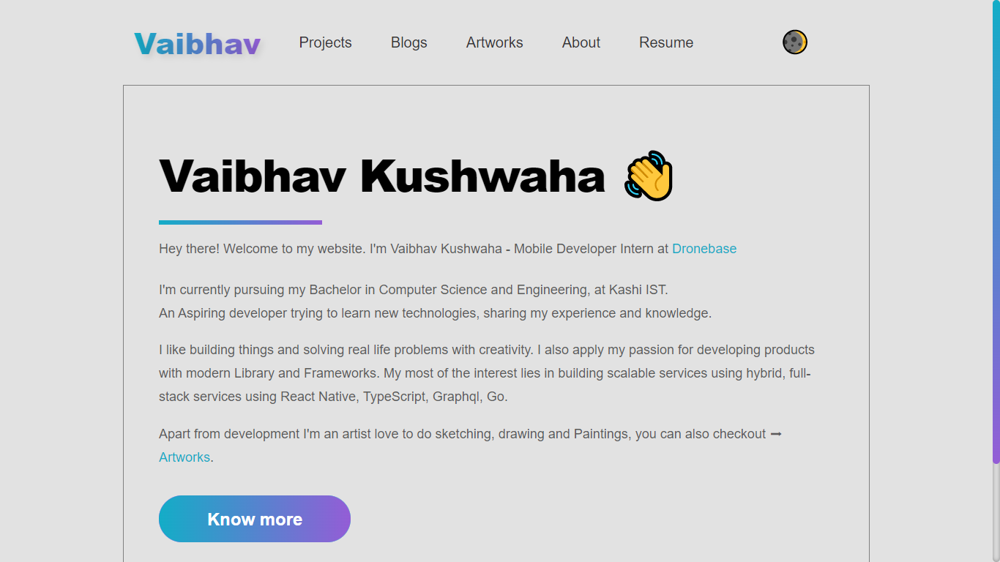

# Vaibhav Kushwaha

Personal portfolio for Vaibhav Kushwaha, a software developer since January 2023 with 3+ years building backend systems in Go and TypeScript. The site presents that experience, along with projects and artwork.

Live site: [https://vaibhav-kushwaha.vercel.app/](https://vaibhav-kushwaha.vercel.app/)



## Stack

- Next.js
- React
- styled-components
- JavaScript
- Vercel

## Features

- Responsive design
- Light and dark theme (dark by default)
- Resume and experience
- Projects
- Artwork and contact (contact is on the about and artwork pages)

## Local setup

From the repository root, with Node.js and npm installed:

```bash
npm install
npm run dev
npm run build
```

`npm run dev` serves the site at [http://localhost:4000](http://localhost:4000). `npm run build` produces a production build.

## Repository layout

- `src/pages` — home, projects, artworks, about, and resume routes
- `src/components` — section UI, including contact
- `src/constants` — copy, project entries, resume data, and artwork entries
- `src/styles` and `src/themes` — shared styles and the light and dark themes
- `public` — static files, including the preview image

Site copy and entries live in `src/constants`. Section layout lives in `src/components`.
